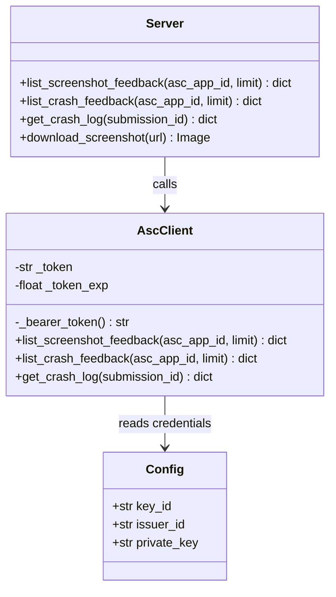
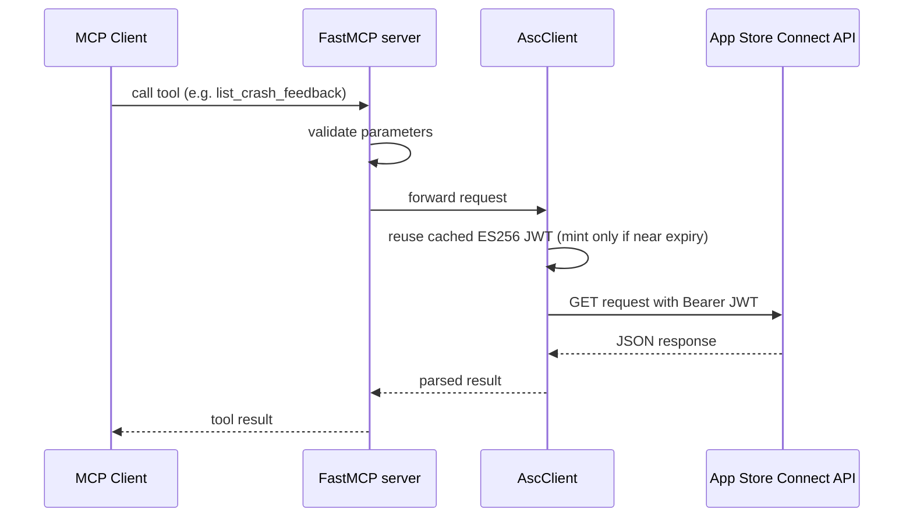

# asc-feedback-mcp

An MCP (Model Context Protocol) server that exposes **App Store Connect
TestFlight beta feedback** — screenshot submissions, crash submissions, crash
logs, and screenshot downloads — as tools for MCP-capable clients. It
authenticates to the App Store Connect API with a short-lived ES256 JWT minted
from your `.p8` API key, so an assistant can pull and triage beta-tester
feedback without you ever pasting raw credentials into a conversation. The
server runs in Docker and speaks streamable-HTTP MCP at
`http://127.0.0.1:8081/mcp`.

## Features

- 4 tools available for listing and inspecting TestFlight beta feedback and
  downloading feedback screenshots.
- Streamable-HTTP MCP transport, served at `http://127.0.0.1:8081/mcp`.
- Docker-based deployment via `docker compose` — no local Python environment
  needed.
- Binds to `127.0.0.1` only; the service is unauthenticated and must never be
  exposed beyond the local machine.

## Architecture





## Usage

The server speaks MCP over **streamable-http** at:

```
http://127.0.0.1:8081/mcp
```

### Tools

| Tool | Parameters | Description |
|------|-----------|-------------|
| `list_screenshot_feedback` | `asc_app_id: str`, `limit: int = 50` | List the most recent TestFlight screenshot feedback submissions for an app. Returns raw App Store Connect API JSON. `asc_app_id` is the app's numeric Apple ID. |
| `list_crash_feedback` | `asc_app_id: str`, `limit: int = 50` | List the most recent TestFlight crash feedback submissions for an app. Returns raw App Store Connect API JSON. `asc_app_id` is the app's numeric Apple ID. |
| `get_crash_log` | `submission_id: str` | Fetch the crash log for one crash feedback submission. Returns raw App Store Connect API JSON (`.data.attributes.logText` holds the log). |
| `download_screenshot` | `url: str` | Download a TestFlight feedback screenshot and return it as image content. Host validation is best-effort: requires https and an Apple-owned hostname. |

`asc_app_id` must contain digits only, and `limit` must be between 1 and 200
inclusive. `submission_id` may only contain letters, digits, and dashes.

### Example MCP client config

```json
{
  "mcpServers": {
    "asc-feedback": {
      "type": "streamable-http",
      "url": "http://127.0.0.1:8081/mcp"
    }
  }
}
```

Or with Claude Code:

```bash
claude mcp add --transport http asc-feedback http://127.0.0.1:8081/mcp
```

The host port (`8081`) is configurable in `docker-compose.yaml`, but the bind
address must always keep the `127.0.0.1:` prefix — never change it to
`0.0.0.0` or otherwise expose it publicly.

## Getting Started

### Prerequisites

- Docker Desktop or Docker Engine with Docker Compose.
- An App Store Connect API key.

### Get an App Store Connect API key

In App Store Connect, go to **Users and Access → Integrations → App Store
Connect API** (Team Keys) and generate a key there. This gives you the
**Issuer ID** (shown at the top of that page), the **Key ID** (in the keys
table), and a downloadable `.p8` private key file (e.g.
`AuthKey_ABC123DEFG.p8`) — save this file, as Apple only lets you download it
once.

| Value | Where it comes from |
|-------|----------------------|
| `ASC_KEY_ID` | Users and Access → Integrations → App Store Connect API, keys table |
| `ASC_ISSUER_ID` | Users and Access → Integrations → App Store Connect API, shown at the top of the page |
| `ASC_PRIVATE_KEY_B64` | Base64 of the `.p8` file downloaded when creating the key above |
| `asc_app_id` (tool parameter) | Apps → *(your app)* → App Information → General Information → Apple ID |

### Steps

1. Clone this repository.
2. Copy the environment template:

   ```bash
   cp .env.example .env
   ```

3. Edit `.env` and fill in:
   - `ASC_KEY_ID` — the API key id from Integrations.
   - `ASC_ISSUER_ID` — the issuer id from Integrations.
   - `ASC_PRIVATE_KEY_B64` — the base64-encoded contents of your `.p8` file,
     produced with:

     ```bash
     base64 -i AuthKey_XXXX.p8 | tr -d '\n'
     ```

4. Build and start the server:

   ```bash
   docker compose up -d --build
   ```

5. Verify it's running by initializing an MCP session against the endpoint:

   ```bash
   curl -i http://127.0.0.1:8081/mcp \
     -H "Content-Type: application/json" \
     -H "Accept: application/json, text/event-stream" \
     -d '{"jsonrpc":"2.0","id":1,"method":"initialize","params":{"protocolVersion":"2024-11-05","capabilities":{},"clientInfo":{"name":"verify","version":"1.0"}}}'
   ```

   Alternatively, add the server to an MCP client using the example config
   above, and confirm all 4 tools (`list_screenshot_feedback`,
   `list_crash_feedback`, `get_crash_log`, `download_screenshot`) appear.

## Security

This service implements **no authentication**. It binds to `127.0.0.1` only
and must never be exposed on `0.0.0.0` or any public/non-loopback interface —
anyone who can reach the port can pull your beta feedback using your App Store
Connect credentials.
